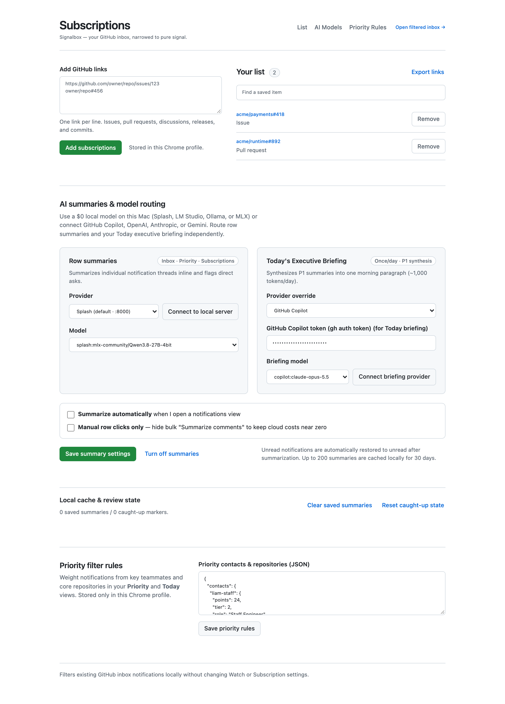
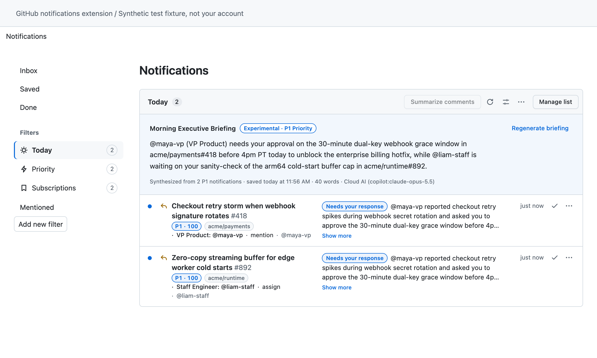
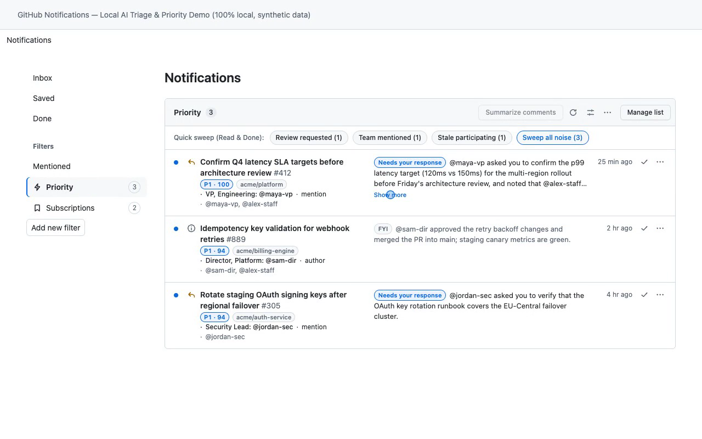
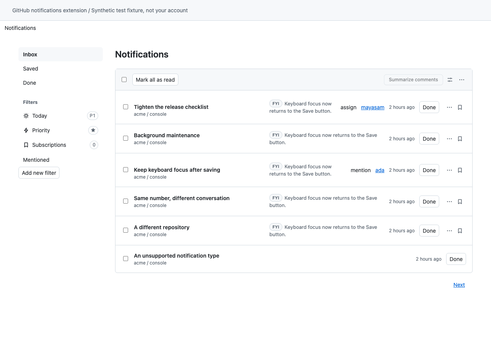

# Changelog

All notable user-facing improvements to **Signalbox** are documented in this file.
This project adheres to [Keep a Changelog](https://keepachangelog.com/en/1.1.0/) and [Semantic Versioning](https://semver.org/).

---

## [Unreleased]

---

## [1.7.0] - 2026-10-29

### Added
- **Editable Today's P1s prompt:** Customize the tone, length, or focus of the Today summary with up to 2,000 characters of your own instructions. Open **Edit prompt** on the card, or **Settings → Edit the Today's P1s prompt**. Your instructions are saved locally with your settings and can be reset to the default at any time. The fixed rules that keep the format and links intact are shown read-only.

### Changed
- **"Today's Executive Briefing" is now "Today's P1s, summarized":** Instead of one long paragraph, you get a one-line headline (the first thing to do) and a short list grouped into **Needs your response**, **Unclear asks**, and **FYI**. Each item shows the full issue or pull request title as a link, the `owner/repo#N` reference, and one line on what you need to do. Summaries saved in the old format are regenerated.

### Fixed
- **Wrong role in the Today summary:** The summary now uses the role of the person who wrote the latest comment. Before, it could borrow the role of a more senior person elsewhere in the thread.
- **"Nothing to preview" summaries:** Signalbox no longer reads GitHub's empty comment-box preview as the latest comment. Summaries now use the real latest comments, and exact comment previews work on comments you can edit. Summaries saved before this fix are regenerated.

---

## [1.6.0] - 2026-10-26

### Added
- **Cloud & GitHub Copilot Providers:** Added optional support for **GitHub Copilot** (`api.githubcopilot.com`, supporting both `/chat/completions` and `/responses` models plus `copilot:auto`), **OpenAI** (`api.openai.com`), **Anthropic** (`api.anthropic.com`), and **Google Gemini** (`generativelanguage.googleapis.com`) alongside local engines (**Splash**, **Local MLX**, **LM Studio**, and **Ollama**).
- **Two-Slot Hybrid Model Routing:** Configure **Row summaries** (`Inbox`, `Priority`, `Subscriptions`) and **Today's Executive Briefing (`#today`)** independently—for example, keeping bulk row summaries on a `$0` local model while routing the once-a-day `#today` synthesis (~1,000 tokens/day) to a frontier model (`copilot:claude-opus-5.5` or `gemini-2.5-pro`).
- **Near-Zero-Cost Controls (`Manual row clicks only`):** Added a one-click toggle that hides bulk `Summarize comments` and disables automatic on-load summarization so cloud tokens are only spent when you explicitly click `Summarize` on a specific row.
- **Automatic Cloud-to-Local Fallback with UI Warnings:** If a selected cloud model is unavailable or rate-limited, Signalbox automatically falls back to the next available Copilot/cloud model and then to your local engine (`Splash :8000` / `MLX :8080`)—displaying an amber **`Local fallback`** warning pill so you never get stuck without a summary.

### Changed
- **Redesigned Settings & List Manager (`manager.html`):** Reorganized the settings page into a two-column top workspace (**Add GitHub links** beside **Your list**), side-by-side **Row summaries** and **Today's Executive Briefing** cards, and a compact **Local cache & review state** bar.

---

## [1.5.0] - 2026-10-23

### Added
- **Experimental `Today` View (`#today`) with Morning Executive Briefing:** Filters your inbox to **P1 Priority** notifications (`score >= 70`), automatically summarizes un-summarized P1 threads, and synthesizes a single-paragraph ($\le$250-word) executive briefing above the P1 rows—crafted around Joel Schwartzberg's *Get to the Point* and Paul Graham's *Write Like You Talk* / *How to Write Usefully*.
- **Full-Day Briefing Persistence:** Once generated, Today's briefing is saved for the rest of the calendar day (`today-briefing:v1:<viewer>`) so revisiting **Today** is instant unless you click **Regenerate briefing**.
- **Automatic Unread Restoration (`/notifications/beta/unmark`):** Summarizing or previewing an unread notification immediately restores its unread state on GitHub so unread threads stay unread until you actually open them.

### Changed
- **Top-of-Sidebar Filter Placement:** Moved **Today**, **Priority**, and **Subscriptions** to the top of GitHub's **Filters** sidebar list.
- **Zero-Jump Native `Done` Handling:** Preloaded cached summaries into RAM and tracked per-tab check state so GitHub's DOM swap after clicking **Done** never re-runs inference or shifts row layout.

---

## [1.4.0] - 2026-10-22

### Added
- **Splash Local Engine Default (`127.0.0.1:8000`):** Added [Splash](https://github.com/incoai/splash) as the default local inference server while preserving existing saved provider selections.
- **Priority-Ordered Summary Scheduling:** Batch summarization starts the highest-scoring Priority notifications first while running in parallel up to the model's context window token budget.

---

## [1.3.0] - 2026-10-20

### Added
- **Smart `Priority` View (`#priority`) with 4-Hour Pinned Snapshot:** Scores notifications (0–100) using direct asks/mentions, organizational hierarchy & core repository rules (`priority-config.local.json` / settings UI), a 72-hour bimodal SLA recency curve, and optional local **Kev-4B** (`127.0.0.1:8009/v1/systemone`) triage. Locks the Priority list order for 4 hours so clicking into issues and navigating back never reshuffles your list.
- **Inline AI Summaries on *Every* GitHub Filter View:** Added **Summarize comments** and per-row **Summarize** to native GitHub views (`Inbox`, `Mentioned`, `Assigned`, `Participating`, `Review requested`, custom filters) in addition to **Priority** and **Subscriptions**.
- **One-Click Quick Sweep (`Read & Done`):** Batch-archive noisy `Review requested`, `Team mentioned`, and `Stale participating` threads directly from the header.
- **Multi-Stage Thread Fallback Extraction:** Extracts React `embeddedData` JSON, opening issue/PR descriptions, earlier `@mention` comments, and the latest 3 timeline comments when a notification has no `#issuecomment-` anchor.

