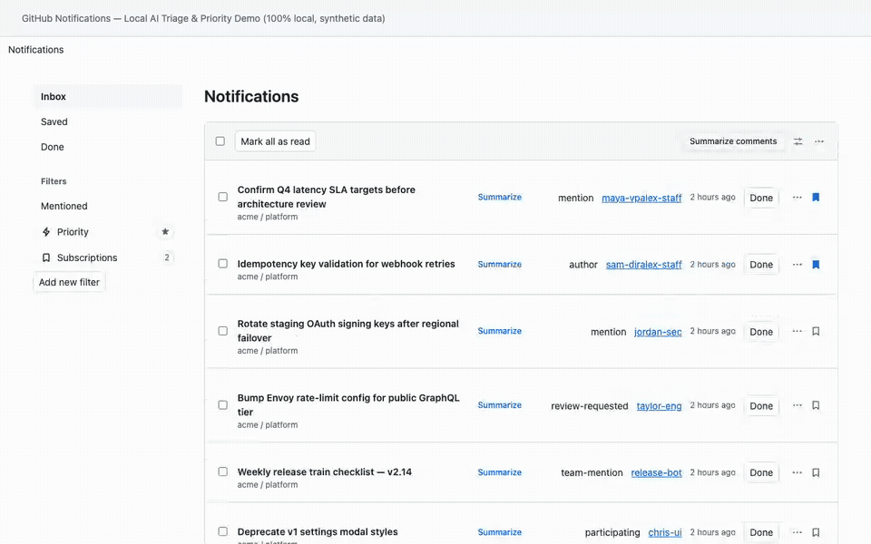

# Signalbox

[](CHANGELOG.md)
[](manifest.json)
[](docs/HOW_IT_WORKS.md#4-ai-summarization-pipeline-local-cloud--two-slot-hybrid-routing)
[](test/)
[](LICENSE)

> **Turn GitHub's notification firehose into pure signal—locally on your Mac or with your choice of Cloud / GitHub Copilot models.**

Signalbox is an unpacked Chrome extension that adds **Today**, **Priority**, and **Subscriptions** views to GitHub notifications, summarizes threads inline across *every* filter view using local AI (Splash, Apple MLX, LM Studio, or Ollama) or optional cloud models (**GitHub Copilot**, **OpenAI**, **Anthropic**, **Google Gemini**), and sweeps noisy notifications in one click.

No build step required. Keep costs at **$0** with 100% local inference, or mix and match—such as local models for bulk row summaries and a frontier cloud/Copilot model for your once-a-day **Today's P1s** summary.



*([Watch the 19-second full-resolution MP4 demo with voice-over](docs/demo.mp4))*

## Highlights

- **Today's P1s, summarized (`#today`):** Summarizes your **P1 Priority** notifications into a one-line headline and a short list grouped by **Needs your response**, **Unclear asks**, and **FYI**. Each item links the full issue or PR title. You can edit the prompt's style instructions in settings.
- **Inline AI summaries on every filter view (without losing unread state):** Works in `Inbox`, `Mentioned`, `Assigned`, `Participating`, custom filters, **Today**, **Priority**, and **Subscriptions**. Unread notifications that get summarized are automatically restored to unread (`POST /notifications/beta/unmark`) right after their source page is fetched. Every summary addresses you in the second person, leads with a status pill (**`Needs your response`**, **`FYI`**, or **`Unclear ask`**), and cites a verbatim quote when you're mentioned.
- **Smart `Priority` view (`#priority`):** Ranks notifications (0–100) by direct asks, your team/repo rules, and a 72-hour SLA recency curve. Pins the list for 4 hours so rows never jump around while you work through them.
- **Deliberate `Subscriptions` view (`#subscriptions`):** Bookmark specific issues, PRs, discussions, releases, or commits from anywhere on GitHub and track them in one calm view across all inbox pages.
- **Multi-stage thread extraction:** Pulls the exact linked comment or falls back to the issue/PR description, earlier `@mention` comments, and the last 3 timeline updates from GitHub's embedded JSON.
- **Context-window parallel AI (Local, Cloud, or Hybrid Two-Slot):** Schedules concurrent summaries up to your model's token budget across local engines (Splash `:8000`, Local MLX `:8080`, LM Studio `:1234`, Ollama `:11434`, plus optional Kev triage on `:8009`) or cloud providers (**GitHub Copilot**, **OpenAI**, **Anthropic**, **Google Gemini**). Route bulk row summaries to a `$0` local model while optionally routing your once-a-day **Today** briefing to a frontier model—or enable **Manual row clicks only** to keep cloud spend near zero.
- **One-click Quick Sweep (`Read & Done`):** Batch-archive `Review requested`, `Team mentioned`, and `Stale participating` noise directly from the header.

## Install

1. Clone this repo:
   ```bash
   git clone https://github.com/gaurav-ketkar/signalbox.git
   ```
2. Open `chrome://extensions` in Chrome (120+) and enable **Developer mode**.
3. Click **Load unpacked** and select the `signalbox` folder.
4. Pin **Signalbox** in Chrome's toolbar and refresh your open GitHub tabs.

## Quick Setup

### 1. Connect a Local or Cloud Model
1. Click the **Signalbox** toolbar icon $\rightarrow$ **Manage list** (or click **Set up local summaries** on `github.com/notifications`).
2. Pick your **Row summaries provider** (**Splash**, **Local MLX**, **LM Studio**, **Ollama**, or **GitHub Copilot** / **OpenAI** / **Anthropic** / **Google Gemini**), click **Connect**, select a model, and click **Save summary settings**.
3. *(Optional)* Under **Model for Today's P1s**, keep **"Same as row summaries model"** or pick a dedicated frontier model (e.g., `copilot:claude-opus-5.5` via `gh auth token`) just for the once-a-day summary. Open **Edit the Today's P1s prompt** to change its tone or focus.

### 2. Customize Priority Rules (Optional)
Open the extension's **Manage list** page (`manager.html`) and edit **Priority filter rules**—or create a gitignored `priority-config.local.json` in the repo root:

```json
{
  "contacts": {
    "octocat": { "tier": "Leadership", "role": "VP Engineering", "points": 18 },
    "hubot": { "tier": "Core peer", "role": "Staff Engineer", "points": 12 }
  },
  "coreRepos": ["acme/platform", "acme/console"],
  "adjacentRepos": ["acme/docs"]
}
```

## Documentation & Development

- **[Changelog & Visual Release History](CHANGELOG.md)** — Version history (`v1.8.0` $\rightarrow$ `v1.3.0`) with feature breakdowns and screenshots.
- **[How Signalbox Works](docs/HOW_IT_WORKS.md)** — Deep dive into Priority scoring, Splash/MLX/Ollama/Cloud setup, multi-stage comment extraction, SHA-256 summary caching, local `Caught up` state, and privacy guarantees.
- **[Contributing Guide](CONTRIBUTING.md)** — Design principles and privacy guardrails.

```bash
npm test              # Unit tests
npm run test:browser  # Playwright MV3 browser tests
```

## License

[Apache-2.0](LICENSE)
